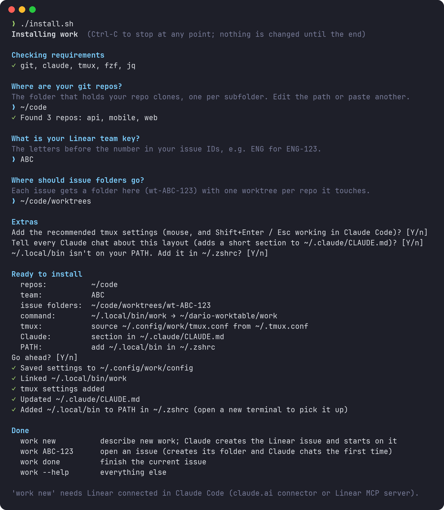

This is how I create, solve and review issues on Mac.

One tmux session per Linear issue, with two Claude Code chats each: an
implementer and a read-only reviewer. Chats are resumed after reboots.

Each issue gets a folder `wt-ABC-123`, with one git worktree per repo it
touches, on branch `abc-123`.

## Install

Needs macOS, `git`, `claude`, `tmux`, `fzf` and `jq` (`gh` optional).

```sh
git clone git@github.com:AngeloSchulerPiletti/dario-worktable.git
cd dario-worktable && ./install.sh
```

The installer asks for your repos folder and Linear team key, and nothing changes
until you confirm. Rerun it to change settings.



## Usage

```
work                 pick an issue and open it
work ABC-123         open an issue
work new             describe new work; Claude creates the Linear issue
work done            finish the current issue (removes its worktrees)
work --help          everything else
```
